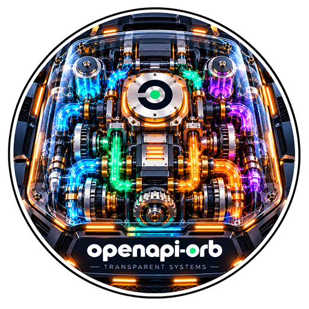
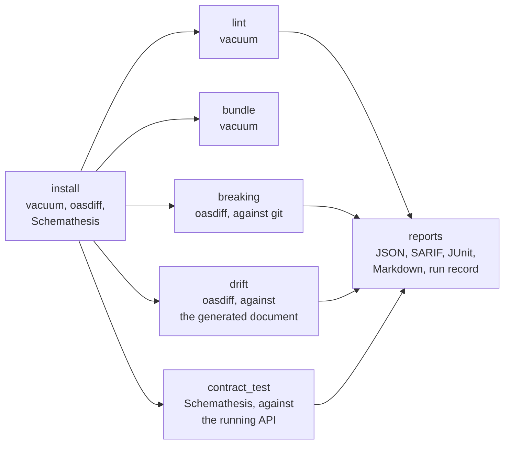

<div align="center">



# OpenAPI for CircleCI and GitHub Actions

### Lint OpenAPI documents, catch the changes that break clients, keep the document in step with the code, and test the running API against it.

Install a checksum-verified [vacuum](https://quobix.com/vacuum/), [oasdiff](https://www.oasdiff.com) and [Schemathesis](https://schemathesis.readthedocs.io/), and check your API's OpenAPI documents on every commit, as orb commands or GitHub Actions.<br>
Any language: the orb reads documents and speaks HTTP · OpenAPI 2.0 to 3.2 · Breaking changes against the base branch, with no second checkout<br>
Gates that tell findings from failures · SARIF, JUnit and run records · No `sudo`

[](https://circleci.com/gh/juburr/openapi-orb)
[](https://github.com/juburr/openapi-orb/actions/workflows/actions.yml)
[](https://circleci.com/developer/orbs/orb/juburr/openapi-orb)
[](LICENSE)
[](https://discuss.circleci.com/c/ecosystem/orbs)


**[Quick Start](#-quick-start)** · **[Features](#-why-openapi-orb)** · **[Recipes](#-recipes)** · **[Commands](#-commands)** · **[GitHub Actions](#-github-actions)** · **[Security](#-secure-by-design)** · **[Network Access](#-network-access)**

<sub>An unofficial, community-maintained CircleCI orb and set of GitHub Actions, not affiliated with the OpenAPI Initiative, the Linux Foundation, or the vacuum, oasdiff and Schemathesis projects. [Contributions are welcome!](#-contributing)</sub>

</div>

<br>

## ✨ Why openapi-orb?

<table>
<tr>
<td width="33%" valign="top">
📦 <b>Tools you can trust</b><br><br>
vacuum and oasdiff are checked against this orb's SHA-512 tables before they run; vacuum's tables are anchored to its Sigstore-signed checksums. Schemathesis installs with a verified uv, from a lock that pins every wheel by SHA-256, into an environment of its own.
</td>
<td width="33%" valign="top">
🧹 <b>Lint with the rules you choose</b><br><br>
<code>lint</code> checks that each document is valid OpenAPI, then applies vacuum's recommended rules, your Spectral-compatible ruleset, or with <code>hard_mode</code> every built-in rule and the OWASP API security rules. A <code>vacuum.conf.yaml</code> in the checkout can't quietly turn rules off.
</td>
<td width="33%" valign="top">
💥 <b>Breaking changes, caught on the pull request</b><br><br>
<code>breaking</code> compares each document with itself where your branch left the base branch, which oasdiff reads straight from git, <code>$ref</code>s to other files included. It writes a Markdown changelog for the pull request and SARIF for code scanning.
</td>
</tr>
<tr>
<td width="33%" valign="top">
🔁 <b>No drift between code and document</b><br><br>
Generate the document from the code in any language, and <code>drift</code> compares it with the committed one as data, not text: key order, YAML or JSON and formatting don't count, a changed field does.
</td>
<td width="33%" valign="top">
🧪 <b>The running API, tested</b><br><br>
<code>contract_test</code> has Schemathesis send thousands of generated requests to the API your job started, and check every response against the document: server errors, undocumented status codes, wrong content types, and bodies that don't match their schemas.
</td>
<td width="33%" valign="top">
🚦 <b>Gates you can trust</b><br><br>
Findings fail the step unless <code>report_only</code> is true. A tool that crashed, a document that isn't OpenAPI, which oasdiff would compare as empty, a bundle with a reference left unresolved, or a contract test that tested nothing fails it either way.
</td>
</tr>
</table>

### 🧩 The Orb vs. a Hand-Rolled Script

| | Hand-rolled | openapi-orb |
|---|---|---|
| Installing the tools | `npm install`, `go install` or `pip install` of whatever is newest today | checksum-verified releases, and a hash-pinned lock for Schemathesis |
| A `vacuum.conf.yaml` with `turbo: true` | the schema rules silently stop running | never read: the parameters decide |
| Comparing with the base branch | a second checkout, and a script to find the base | oasdiff reads it from git; the merge base by default |
| A Swagger 2.0 or non-OpenAPI file | oasdiff loads it as an empty document, and finds no breaking change | fails, saying so |
| A partial bundle | vacuum writes it, and exits 0 | every reference must resolve, or nothing is written |
| A contract test the API never answered | exit code 1, the same as a failed check | no verdict, whatever `report_only` says |
| An auth token for the contract test | on the command line | a `${NAME}` placeholder Schemathesis fills in from the environment |

## 🔄 How It Works



1. **`install`** puts the tools named in `tools` on the `PATH`, each verified first.
2. **`lint`**, **`breaking`**, **`drift`** and **`contract_test`** each run their tool, write the reports, and fail the step on findings. **`bundle`** writes one document from a document split across files.

## 🚀 Quick Start

### CircleCI

```yaml
version: 2.1

orbs:
  openapi: juburr/openapi-orb@0.1.0

jobs:
  openapi:
    docker:
      - image: cimg/base:current
    steps:
      - checkout
      - openapi/install
      - openapi/lint
      - openapi/breaking

workflows:
  openapi:
    jobs:
      - openapi
```

`lint` and `breaking` check `openapi.yaml` (or `openapi.json`, `swagger.yaml`...) in the working directory; name others in `specs`. `breaking` compares it with the merge base of the remote's default branch, so CircleCI's full checkout has what it needs. The reports are in the job's artifacts under `openapi-reports/`, and the findings in its Tests tab.

### GitHub Actions

```yaml
jobs:
  openapi:
    runs-on: ubuntu-24.04
    permissions:
      contents: read
      security-events: write
    steps:
      - uses: actions/checkout@v7
        with:
          fetch-depth: 0 # breaking reads the base branch from git
      - uses: juburr/openapi-orb/actions/install@v0.1.0
      - uses: juburr/openapi-orb/actions/lint@v0.1.0
      - uses: juburr/openapi-orb/actions/breaking@v0.1.0
      - uses: github/codeql-action/upload-sarif@v4
        if: always()
        with:
          sarif_file: /tmp/openapi-reports
```

On a pull request, `breaking` compares with the pull request's base branch.

## 🍳 Recipes

### Adopt the Checks Gradually

```yaml
- openapi/lint:
    report_only: true
- openapi/breaking:
    fail_on: error # ERR changes only; warn adds the ones that may break clients
```

`report_only` writes every report and passes; a check that couldn't run still fails.

### Lint With Your Own Rules

```yaml
- openapi/lint:
    specs: api/*.yaml
    ruleset: .spectral.yaml # extends: [[vacuum:oas, recommended], [vacuum:owasp, all]]
    ignore_file: .vacuum-ignore.yaml
    fail_on: warn
```

A ruleset that doesn't extend `vacuum:oas` (or `spectral:oas`) leaves out the schema rules, so the documents' validity is no longer checked.

### Accept a Breaking Change

```yaml
- openapi/breaking:
    err_ignore: .oasdiff-err-ignore.txt # "DELETE /items/{id} api removed without deprecation"
    severity_levels: .oasdiff-levels.txt # "response-property-enum-value-added warn"
```

Or compare a release branch with its last tag rather than a branch: `base_ref: v1.4.0` and `merge_base: false`.

### Keep a Generated Document in Step With the Code

```yaml
- run:
    name: Generate the document from the code
    command: python -m myapp.export_openapi > openapi.generated.json
- openapi/drift:
    spec: openapi.yaml
    generated: openapi.generated.json
    exclude_elements: description,examples
```

Any language works: FastAPI, springdoc, NestJS, swag or utoipa can write the document. When the generator writes over the committed file, leave `generated` empty: the working tree's copy is compared with the one in `HEAD`.

### Test the Running API

```yaml
- run:
    name: Start the API
    background: true
    command: ./bin/server --port 8080
- openapi/install:
    tools: schemathesis
- openapi/contract_test:
    spec: openapi.yaml
    url: http://localhost:8080
    headers: |
      Authorization: Bearer ${API_TOKEN}
    max_examples: "50"
```

`contract_test` waits up to `wait_for_api` seconds for the API to answer. Schemathesis fills in `${API_TOKEN}` from the environment as it runs, so the token reaches neither a file nor a command line. Never point it at a production API.

### Bundle a Multi-File Document

```yaml
- openapi/bundle:
    spec: api/openapi.yaml
    output: dist/openapi.yaml
```

### Upload SARIF to GitHub Code Scanning

`lint` and `breaking` write `<report_name>.sarif` in `output_dir`, with paths relative to the top of the checkout. On GitHub Actions, upload them with `github/codeql-action/upload-sarif`.

### Keep a Run Record

`run_record: true` writes `<report_name>.run-record.json`: the tool and how it was installed, its arguments, the documents and policy files with their SHA-256, what it found, and the CI job. [`schemas/run-record.v1.json`](schemas/run-record.v1.json) describes it.

## 🧰 Commands

| Command | What it does |
|---|---|
| [`install`](#openapiinstall) | Installs the tools named in `tools` |
| [`install_vacuum`](#openapiinstall_vacuum) | Installs vacuum, verified against this orb's checksum table |
| [`install_oasdiff`](#openapiinstall_oasdiff) | Installs oasdiff, verified against this orb's checksum table |
| [`install_uv`](#openapiinstall_uv) | Installs uv, verified against this orb's checksum table |
| [`install_schemathesis`](#openapiinstall_schemathesis) | Installs Schemathesis from this orb's lock |
| [`lint`](#openapilint) | Lints documents with vacuum |
| [`bundle`](#openapibundle) | Bundles a multi-file document into one |
| [`breaking`](#openapibreaking) | Finds the changes that break clients, against a git revision or a file |
| [`drift`](#openapidrift) | Compares the generated document with the committed one |
| [`contract_test`](#openapicontract_test) | Tests a running API against its document |

Every parameter that names a value expands environment variables, except `output_dir`, which `store_artifacts` reads too, and `contract_test`'s `headers`. The checks share these parameters:

| Parameter | Default | Description |
|---|---|---|
| `working_dir` | `.` | The directory to run in; paths are relative to it |
| `output_dir` | `/tmp/openapi-reports` | Absolute path of the directory for the reports |
| `report_name` | the command's | The reports' file name without its extension |
| `junit` | `true` | Write JUnit to `output_dir/junit/<report_name>.xml` and store it |
| `run_record` | `false` | Also write `<report_name>.run-record.json` |
| `report_only` | `false` | Report findings without failing the step |
| `extra_args` | | Further options for the tool, split like shell words, nothing expanded or run; options the command sets are refused |
| `store_artifacts` | `true` | Store `output_dir` under `openapi-reports/`, also when the step fails |

### `openapi/install`

| Parameter | Default | Description |
|---|---|---|
| `tools` | `vacuum,oasdiff` | Any of `vacuum`, `oasdiff`, `schemathesis` and `uv`, separated by commas or spaces |
| `vacuum_version` | `0.35.2` | The vacuum release |
| `oasdiff_version` | `1.34.1` | The oasdiff release |
| `schemathesis_version` | `4.32.4` | The Schemathesis release |
| `uv_version` | `0.13.6` | The uv release, for Schemathesis |
| `python` | `3.14` | `3.11` to `3.14` for a CPython uv downloads, `system`, or an interpreter's absolute path |
| `index_url` | `https://pypi.org/simple` | The package index to install Schemathesis from |
| `python_install_mirror` | | A mirror of uv's Python downloads, `https://` or `file://` |
| `download_base_url` | | A mirror of GitHub Releases, in place of `https://github.com` |
| `caching` | `true` | Cache the verified releases and the Python archive between jobs |
| `install_path` | `~/.openapi-orb/bin` | Where the tools go, added to the `PATH` ahead of any an image ships |
| `verify_checksums` | `strict` | `strict`, `known_versions` or `false` (see [Checksum Verification](#-checksum-verification)) |

### `openapi/install_vacuum`

| Parameter | Default | Description |
|---|---|---|
| `version` | `0.35.2` | The vacuum release, from 0.30.0 |
| `verify_checksums` | `strict` | `strict`, `known_versions` or `false` |
| `install_path` | `~/.openapi-orb/bin` | Directory for `vacuum`, added to the `PATH` |
| `download_base_url` | | An https mirror of GitHub Releases |
| `caching` | `true` | Cache the verified release between jobs |

### `openapi/install_oasdiff`

As `install_vacuum`, with `version` defaulting to `1.34.1`, from 1.30.0.

### `openapi/install_uv`

As `install_vacuum`, with `version` defaulting to `0.13.6`, from 0.13.0. `install_schemathesis` runs it first unless `install_uv` is false.

### `openapi/install_schemathesis`

`version` (default `4.32.4`), `python`, `index_url`, `python_install_mirror`, `caching`, `install_path`, `verify_checksums`, `download_base_url` and `uv_version`, as for `install`, and `install_uv` (default `true`): install uv first, or use the one an earlier `install_uv` put in `install_path`. Schemathesis runs from its own environment with `python -I`, through a script named `schemathesis` in `install_path`.

### `openapi/lint`

| Parameter | Default | Description |
|---|---|---|
| `specs` | | Documents or globs; empty for `openapi.yaml`, `openapi.yml`, `openapi.json`, `swagger.yaml`, `swagger.yml` or `swagger.json` |
| `ruleset` | | A Spectral-compatible ruleset file or https URL; empty for vacuum's recommended rules |
| `hard_mode` | `false` | Every built-in rule and the OWASP API security rules |
| `functions` | | A directory of custom JavaScript functions |
| `ignore_file` | | A vacuum ignore file |
| `fail_on` | `error` | The lowest severity that is a finding: `error`, `warn`, `info` or `hint` |
| `report_name` | `lint` | |

vacuum runs once per document, as `spectral-report`. Reports: `<report_name>.json` (every result, in Spectral's format, with its document), `<report_name>.sarif`, and JUnit, with results below `fail_on` as skipped cases. A document vacuum can't read, or a ruleset it can't load, fails the step either way. vacuum never reads a `vacuum.conf.*` or a `VACUUM_*` variable, which could turn rules off: the parameters decide. `--turbo`, `--skip-check`, `--changes` and `--original`, which would narrow what is checked, are refused in `extra_args`.

### `openapi/bundle`

| Parameter | Default | Description |
|---|---|---|
| `spec` | (required) | The document to bundle |
| `output` | (required) | The file to write, which can't be `spec` |
| `format` | `auto` | `auto` (JSON for a `.json` output, else YAML), `yaml` or `json` |
| `composed` | `false` | Move external components into `components`, instead of inlining each where it's used |
| `extra_args` | | Further options for `vacuum bundle`, such as `--remote=false` |

vacuum looks for references from the document's directory. Its bundle must be an OpenAPI (or AsyncAPI) document whose every remaining `$ref` points inside it at something that is there; otherwise nothing is written and the step fails.

### `openapi/breaking`

| Parameter | Default | Description |
|---|---|---|
| `specs` | | Documents or globs, as for `lint` |
| `base_ref` | | The branch, tag or commit to compare with; empty for the pull request's base branch on GitHub Actions, or else `origin/HEAD`, `origin/main` or `origin/master` |
| `merge_base` | `true` | Compare with where this branch left `base_ref`, not `base_ref` itself |
| `base_spec` | | Where the document was at the base, when it has moved (one document) |
| `base_file` | | A file to compare with instead of a git revision (one document) |
| `fail_on` | `error` | `error` (oasdiff's ERR) or `warn` (ERR and WARN) |
| `severity_levels` | | An oasdiff severity levels file |
| `err_ignore`, `warn_ignore` | | oasdiff ignore files for ERR and WARN changes |
| `report_name` | `breaking` | |

oasdiff reads the base from git (`<commit>:<path>`), `$ref`s to other files included, from the top of the checkout. A document the base doesn't have is new, and passes. Both documents must be OpenAPI 3.0, 3.1 or 3.2. Reports: `<report_name>.json` (every change, with its level and document), `<report_name>.md` (oasdiff's changelog, for a pull request comment), `<report_name>.sarif` (the breaking changes) and JUnit. An `.oasdiff.yaml` in the checkout still sets oasdiff's policy, such as `severity-levels`; the orb passes the format, level and `--fetch=false` itself.

### `openapi/drift`

| Parameter | Default | Description |
|---|---|---|
| `spec` | (required) | The committed document |
| `generated` | | The document generated from the code; empty when the generator wrote over `spec`, which is then compared with `HEAD`'s copy |
| `exclude_elements` | | Differences that don't count: `examples`, `description`, `title`, `summary`, `extensions`, `endpoints` |
| `report_name` | `drift` | |

Any difference oasdiff's `diff` reports is drift. Reports: `<report_name>.json` (the named changes and the full difference), `<report_name>.diff.json`, `<report_name>.md` and JUnit.

### `openapi/contract_test`

| Parameter | Default | Description |
|---|---|---|
| `spec` | (required) | The document: a file, or the URL the API serves it at |
| `url` | | The API's base URL; required when `spec` is a file |
| `checks` | | Schemathesis checks to run; empty for all of them |
| `exclude_checks` | | Checks to leave out |
| `phases` | | Any of `examples`, `coverage`, `fuzzing` and `stateful`; empty for all |
| `max_examples` | | Test cases per operation in fuzzing and stateful testing; empty for 100 |
| `seed` | | Repeat a run exactly; empty for a random seed, which the report names |
| `workers` | `1` | `1` to `64`, or `auto` |
| `request_timeout` | | Seconds per response; empty for 10 |
| `wait_for_api` | `60` | Seconds to wait for the API to answer first; `0` doesn't wait |
| `headers` | | `Name: value` lines sent with every request; `${NAME}` is filled in by Schemathesis, never expanded by the orb |
| `config` | | A `schemathesis.toml` to run with, instead of the parameters' (not with `headers`) |
| `formats` | | Further reports: `har`, `vcr`, `ndjson`, `html` |
| `allow_empty` | `false` | Let a run that tested nothing pass |
| `report_name` | `contract-test` | |

Schemathesis exits 1 for failed checks and for requests that got no answer alike, so its JSON report (`<report_name>.json`) decides: failures are findings; errors, a run that didn't complete, and one that tested nothing aren't a result. It never reads a `schemathesis.toml` in the checkout unless `config` names it, or runs `SCHEMATHESIS_HOOKS`, and keeps its request cache off and Hypothesis's example database out of the checkout. JUnit is Schemathesis's own, with a curl command that reproduces each failure. `--header` and `--auth`, which would put a secret on the command line, are refused in `extra_args`.

## ⚡ GitHub Actions

Every command has a composite action of the same name, with the same inputs and defaults, running the same scripts:

| Action | Command |
|---|---|
| `juburr/openapi-orb/actions/install@v0.1.0` | `install` |
| `juburr/openapi-orb/actions/install_vacuum@v0.1.0` | `install_vacuum` |
| `juburr/openapi-orb/actions/install_oasdiff@v0.1.0` | `install_oasdiff` |
| `juburr/openapi-orb/actions/install_uv@v0.1.0` | `install_uv` |
| `juburr/openapi-orb/actions/install_schemathesis@v0.1.0` | `install_schemathesis` |
| `juburr/openapi-orb/actions/lint@v0.1.0` | `lint` |
| `juburr/openapi-orb/actions/bundle@v0.1.0` | `bundle` |
| `juburr/openapi-orb/actions/breaking@v0.1.0` | `breaking` |
| `juburr/openapi-orb/actions/drift@v0.1.0` | `drift` |
| `juburr/openapi-orb/actions/contract_test@v0.1.0` | `contract_test` |

What one action exports, later steps see, as with CircleCI's `BASH_ENV`. A few differences:

- **Check out with history** for `breaking` (`fetch-depth: 0`), since `actions/checkout` fetches one commit by default.
- **Quote booleans and numbers** in `with:` (`report_only: "true"`), since every input is a string.
- **Environment variables aren't expanded in inputs.** Use `${{ env.NAME }}` instead; `contract_test`'s `headers` placeholders still work, filled in by Schemathesis from the step's environment.
- **The reports are uploaded as an artifact** named `openapi-reports-<report_name>-<random>`. JUnit stays in `output_dir/junit/` for a test reporter action.
- **The install actions cache with `actions/cache`**, keyed as on CircleCI.
- **Start the API in the background** before `contract_test`, such as with `nohup ./server &`, since a step has no `background: true`.
- **Pin the actions to a commit SHA** for the strongest guarantee: `juburr/openapi-orb/actions/lint@<sha> # v0.1.0`.

## 🔒 Secure by Design

- **Verified downloads.** vacuum, oasdiff and uv are checked against this orb's SHA-512 tables before they run. Schemathesis and every dependency are checked against this orb's lock with `--require-hashes`, wheels only, on a CPython uv checks against the SHA-256 it carries.
- **No settings from the checkout.** vacuum runs with a configuration of the orb's own and no `VACUUM_*` variables; Schemathesis with the orb's `schemathesis.toml` and without `SCHEMATHESIS_HOOKS`. oasdiff reads a repository's `.oasdiff.yaml` for its policy, but never its format, level or fetching.
- **Nothing executed from parameters.** `extra_args` is split like shell words, with nothing expanded or run, and options that would change what is checked or how the report is read are refused.
- **No secrets on command lines.** `contract_test`'s headers go into a configuration file as `${NAME}` placeholders, which Schemathesis fills in from the environment; Schemathesis masks `Authorization` and the like in its output and reports.
- **No network you didn't ask for.** oasdiff never fetches the base (`--fetch=false`), and nothing is uploaded anywhere.
- **No `sudo`.** Everything installs and caches under `HOME`.

## 💻 Supported Platforms

- **Executors.** Linux on amd64 or arm64, with bash 4, curl or wget, tar, gzip, git and jq: `cimg/base`, `cimg/python`, CircleCI's machine images, and GitHub's Ubuntu runners. No Python is needed: `install` brings one for Schemathesis.
- **Documents.** vacuum lints OpenAPI 2.0, 3.0, 3.1 and 3.2 (and AsyncAPI 3). oasdiff compares OpenAPI 3.0, 3.1 and 3.2. Schemathesis tests OpenAPI 2.0 to 3.2.
- **Schemathesis.** CPython 3.11 to 3.14; its aarch64 wheels need glibc 2.28 or newer, or musl.
- **CI.** CircleCI tests every command with the real tools, and the installs on amd64 and arm64; GitHub Actions tests every action the same way.

## 🔐 Checksum Verification

**vacuum.** `src/install/vacuum/install.sh` holds the SHA-512 of the `vacuum` binary in the release archives of every vacuum release from **0.30.0 to 0.35.2**. `src/install/vacuum/install_hash.sh -v <version>` prints new entries after cosign verifies the release's Sigstore-signed `checksums.txt`, as signed by vacuum's publish workflow for the commit the tag names, and the archive against it.

**oasdiff.** `src/install/oasdiff/install.sh` holds the SHA-512 of the `oasdiff` binary for every release from **1.30.0 to 1.34.1**. oasdiff signs nothing, so `src/install/oasdiff/install_hash.sh -v <version>` anchors each entry to the release's `checksums.txt`.

**uv.** `src/install/uv/install.sh` covers uv **0.13.0 to 0.13.6**, checked against each release's `.sha256`.

**Schemathesis.** `src/install/schemathesis/locks.txt` holds a lock for **Schemathesis 4.32.4**, with every dependency pinned and every wheel by SHA-256, for CPython 3.11 to 3.14 on x86_64 and aarch64, glibc and musl. `src/install/lock.sh -t schemathesis -v <version>` writes a new one.

A release goes into a table or a lock only once it is seven days old, so a compromised release has time to come to light.

| Mode | Listed version | Unlisted version |
|---|---|---|
| `strict` (default) | verified | fails before downloading anything |
| `known_versions` | verified | installed **unverified**, with a warning |
| `false` | not verified | not verified |

The install record beside each tool (`.<tool>.install.json`) says which, and the run records include it.

## 🌐 Network Access

| Host | When |
|---|---|
| `github.com` (and its release asset hosts) | installing vacuum, oasdiff and uv, unless `download_base_url` names a mirror or the release comes from the cache; uv also tries `releases.astral.sh` |
| The python-build-standalone release host uv uses | installing a CPython for Schemathesis, unless `python_install_mirror` names a mirror, the archive comes from the cache, or `python` is `system` or a path |
| `pypi.org` and `files.pythonhosted.org` | installing Schemathesis, unless `index_url` names a mirror |
| The hosts a document's remote `$ref`s and a remote ruleset name | `lint` and `bundle` (vacuum follows remote references unless `--remote=false`), and `breaking` and `drift` (oasdiff, unless `--allow-external-refs=false`) |
| The API under test | `contract_test` |

## 🗺️ Not Yet Included

- **AsyncAPI and Arazzo** checks beyond what vacuum's lint reads.
- **Converting Swagger 2.0 to OpenAPI 3** for `breaking` and `drift`.
- **Posting the changelog to the pull request**: `breaking` writes it as Markdown for a step that comments.
- **Mock servers and proxy validation** (Prism), and other contract testing tools.
- **macOS and Windows executors.**

## 🤝 Contributing

```bash
# Lint
yamllint .
shellcheck src/scripts/*.sh src/scripts/lib/*.sh src/install/*.sh src/install/*/*.sh actions/*.sh tests/*.sh

# Offline tests (git, jq, python3, and jsonschema for the run record schema)
for t in tests/*_test.sh; do bash "$t" || break; done

# Pack and validate
circleci orb pack src/ > orb.yml && circleci orb validate orb.yml

# Table entries for a new release, and a lock for a new Schemathesis release
./src/install/vacuum/install_hash.sh -v <version>
./src/install/oasdiff/install_hash.sh -v <version>
./src/install/lock.sh -t schemathesis -v <version>
```

Pull requests run the offline tests, then every command with the real tools on CircleCI (`.circleci/test-deploy.yml`) and every action on GitHub's runners (`.github/workflows/actions.yml`).

## 🎨 Logo

The logo is in [`assets/logos`](assets/logos), from 64 to 1024 pixels.

## 📜 License

[MIT](LICENSE). OpenAPI is a trademark of the Linux Foundation; this project is not affiliated with the OpenAPI Initiative, the Linux Foundation, or the vacuum, oasdiff and Schemathesis projects.
